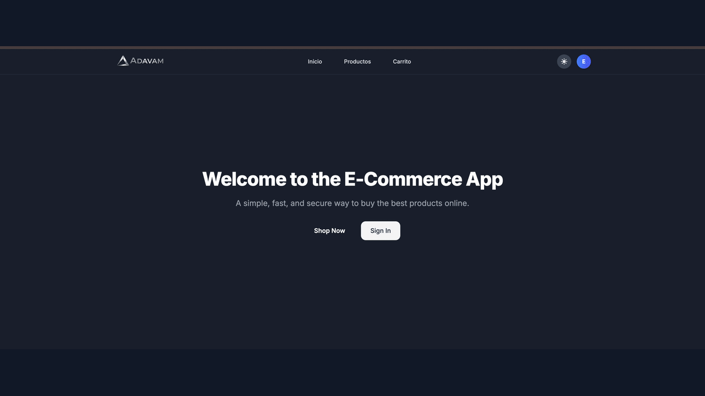
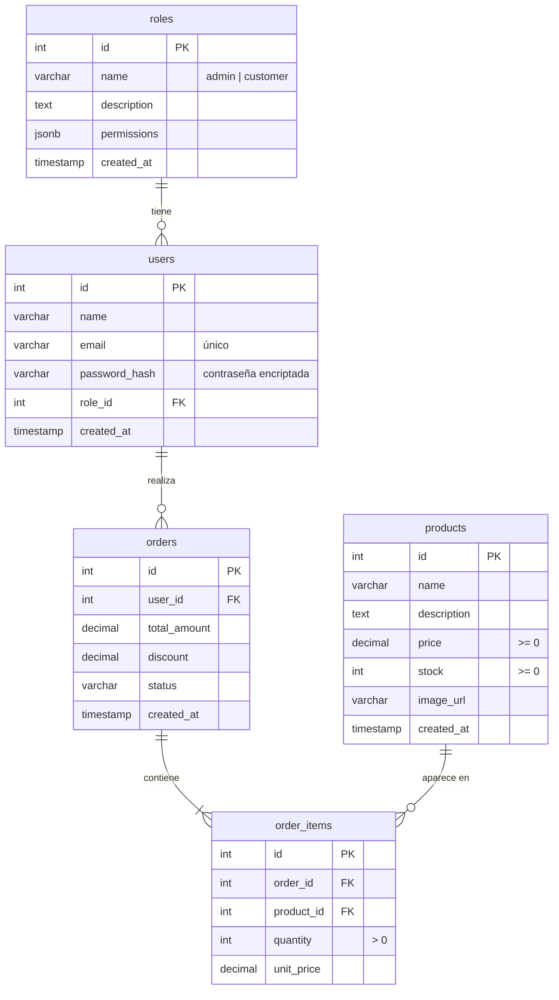
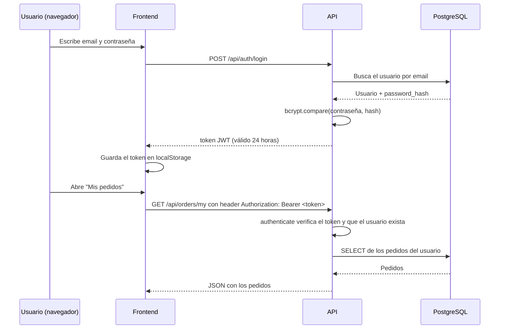

# ADAVAM - E-Commerce & Admin Dashboard

ADAVAM es una tienda en línea completa (**full-stack**) y de **código abierto**. Incluye:

- Una **API REST** (backend) hecha con Node.js + Express y una base de datos PostgreSQL.
- Una **tienda para clientes**, donde se ven productos, se arma el carrito y se hacen pedidos.
- Un **panel de administración**, donde se gestionan productos, usuarios, roles y órdenes.

Esta guía está escrita para que **cualquier persona, incluso si está empezando (junior)**, pueda instalar, entender y ejecutar el proyecto paso a paso.

## 📸 Galería del Proyecto

<p align="center">
  
</p>

---

## 📚 Tabla de contenido

1. [¿Cómo funciona? (Arquitectura)](#-cómo-funciona-arquitectura)
2. [Tecnologías y versiones](#-tecnologías-y-versiones)
3. [Estructura de carpetas](#-estructura-de-carpetas)
4. [Requisitos previos](#-requisitos-previos)
5. [Instalación paso a paso](#-instalación-paso-a-paso)
6. [Variables de entorno](#-variables-de-entorno)
7. [Base de datos](#-base-de-datos)
8. [Endpoints de la API](#-endpoints-de-la-api)
9. [Autenticación con JWT](#-autenticación-con-jwt)
10. [Flujo de una compra](#-flujo-de-una-compra)
11. [Scripts disponibles](#-scripts-disponibles)
12. [Problemas comunes y soluciones](#-problemas-comunes-y-soluciones)
13. [Glosario para juniors](#-glosario-para-juniors)
14. [Proyecto Open Source](#-proyecto-open-source)
15. [Licencia](#-licencia)

---

## 🧭 ¿Cómo funciona? (Arquitectura)

El proyecto está dividido en **piezas independientes** que se comunican por HTTP:

```
┌──────────────────────┐   ┌──────────────────────┐   ┌──────────────────────┐
│  frontend-flowbite   │   │   frontend-admin     │   │      frontend        │
│  Tienda (clientes)   │   │  Panel de admin      │   │ Tienda + admin       │
│  Next.js + Flowbite  │   │  React + Vite        │   │ Next.js + HeroUI     │
│  :3000               │   │  :5173               │   │ :3000 (alternativo)  │
└──────────┬───────────┘   └──────────┬───────────┘   └──────────┬───────────┘
           │   peticiones HTTP (fetch) + token JWT en el header   │
           └──────────────────────────┼───────────────────────────┘
                                      ▼
                         ┌────────────────────────┐
                         │          api           │
                         │   Node.js + Express    │
                         │   :3001  /api/...      │
                         └───────────┬────────────┘
                                     │ SQL (librería pg)
                                     ▼
                         ┌────────────────────────┐
                         │      PostgreSQL        │
                         │   base: ecommerce_db   │
                         │   :5432                │
                         └────────────────────────┘
```

**En palabras simples:**

1. El usuario abre un **frontend** en el navegador.
2. El frontend le pide datos a la **API** (por ejemplo: "dame la lista de productos").
3. La API consulta la **base de datos PostgreSQL** y responde en formato **JSON**.
4. El frontend muestra esos datos en pantalla.

Los frontends **nunca** hablan directamente con la base de datos; siempre pasan por la API. Así la lógica y la seguridad viven en un solo lugar.

### ¿Por qué hay tres frontends?

| Carpeta | Para qué sirve | Recomendado |
|---------|----------------|-------------|
| `frontend-flowbite` | Tienda para **clientes** (productos, carrito, pedidos). | ✅ Tienda principal |
| `frontend-admin` | Panel de **administración** (dashboard, productos, usuarios, órdenes). | ✅ Admin principal |
| `frontend` | Versión alternativa hecha con HeroUI que incluye tienda **y** admin en una sola app (`/admin`). | Opcional / experimental |

Para empezar, solo necesitas la **api**, **frontend-flowbite** y **frontend-admin**.

---

## 🧰 Tecnologías y versiones

Versiones tomadas de los `package.json` de cada proyecto. El símbolo `^` significa "esta versión o una más nueva compatible".

### Entorno general

| Herramienta | Versión recomendada | Para qué se usa |
|-------------|---------------------|-----------------|
| **Node.js** | **22 LTS** o superior (probado con v24.15.0) | Ejecutar JavaScript fuera del navegador |
| **npm** | 10 o superior (probado con 11.21.1) | Instalar dependencias |
| **PostgreSQL** | 14 o superior | Base de datos |
| **Git** | Cualquier versión reciente | Control de versiones |

> ℹ️ Vite 8 y Next.js 16 necesitan Node.js 20.19 o superior. Si usas una versión más vieja, verás errores al iniciar.

### `api` (Backend)

| Paquete | Versión | Para qué se usa |
|---------|---------|-----------------|
| express | ^5.2.1 | Servidor web y rutas de la API |
| pg | ^8.23.0 | Conectarse a PostgreSQL |
| jsonwebtoken | ^9.0.3 | Crear y validar tokens JWT (sesiones) |
| bcrypt | ^6.0.0 | Encriptar (hashear) contraseñas |
| multer | ^2.2.0 | Subir imágenes de productos |
| cors | ^2.8.6 | Permitir que los frontends llamen a la API |
| dotenv | ^17.4.2 | Leer variables del archivo `.env` |
| nodemon *(dev)* | ^3.1.14 | Reiniciar el servidor automáticamente al guardar cambios |

> `sqlite` / `sqlite3` y `api/database.sqlite` son restos de una versión anterior. Hoy la API usa **solo PostgreSQL** (ver `api/db.js`).

### `frontend-flowbite` (Tienda de clientes)

| Paquete | Versión |
|---------|---------|
| next | 15.5.23 (con Turbopack) |
| react / react-dom | 19.1.0 |
| flowbite / flowbite-react | ^4.0.2 / ^0.12.17 |
| tailwindcss | ^4 |
| typescript | ^5 |
| react-hot-toast | ^2.6.0 (notificaciones) |
| react-icons | ^5.7.0 |

### `frontend-admin` (Panel de administración)

| Paquete | Versión |
|---------|---------|
| vite | ^8.2.0 |
| react / react-dom | ^19.2.8 |
| react-router-dom | ^7.18.2 (navegación entre páginas) |
| flowbite / flowbite-react | ^4.0.2 / ^0.12.17 |
| tailwindcss | ^3.4.19 |
| lucide-react | ^1.31.0 (íconos) |
| oxlint *(dev)* | ^1.75.0 (revisar errores de código) |

### `frontend` (Alternativo con HeroUI)

| Paquete | Versión |
|---------|---------|
| next | 16.3.1 |
| react / react-dom | 19.2.8 |
| @heroui/react | ^3.2.4 |
| framer-motion | ^13.1.0 (animaciones) |
| next-themes | ^0.4.6 (modo claro/oscuro) |
| tailwindcss | ^4.3.3 |
| typescript | ^5 |

---

## 🗂️ Estructura de carpetas

```
system-cart-shop/
├── README.md                  ← Este archivo
├── LICENSE                    ← Licencia MIT
├── img/
│   └── slide.gif              ← Capturas del proyecto
├── db/
│   └── schema.sql             ← Crea las tablas y los roles iniciales
│
├── api/                       ← BACKEND (Node.js + Express)
│   ├── index.js               ← Punto de entrada: arranca el servidor y registra las rutas
│   ├── db.js                  ← Conexión a PostgreSQL (pool de conexiones)
│   ├── init_db.js             ← Script que crea la base de datos y ejecuta schema.sql
│   ├── .env.test              ← Plantilla de variables de entorno
│   ├── routes/                ← Define las URLs (qué URL llama a qué función)
│   │   ├── authRoutes.js      ←   /api/auth     (login y registro)
│   │   ├── productRoutes.js   ←   /api/products
│   │   ├── orderRoutes.js     ←   /api/orders
│   │   ├── userRoutes.js      ←   /api/users
│   │   ├── roleRoutes.js      ←   /api/roles
│   │   └── uploadRoutes.js    ←   /api/upload   (subir imágenes)
│   ├── controllers/           ← Lógica: recibe la petición, valida y responde
│   ├── models/                ← Consultas SQL a la base de datos
│   ├── middlewares/
│   │   └── authMiddleware.js  ← Verifica el token JWT y el rol del usuario
│   └── uploads/               ← Imágenes subidas de los productos
│
├── frontend-flowbite/         ← TIENDA DE CLIENTES (Next.js)
│   ├── public/                ← Logos e íconos
│   └── src/
│       ├── app/               ← Cada carpeta es una página (App Router de Next.js)
│       │   ├── page.tsx       ←   /           (inicio)
│       │   ├── products/      ←   /products   (catálogo)
│       │   ├── cart/          ←   /cart       (carrito)
│       │   ├── orders/        ←   /orders     (mis pedidos)
│       │   ├── login/         ←   /login
│       │   ├── layout.tsx     ←   Plantilla común a todas las páginas
│       │   └── Providers.tsx  ←   Envuelve la app con los contextos
│       ├── components/        ← Piezas reutilizables (ej. NavbarComponent)
│       ├── context/           ← Estado global: AuthContext (sesión), CartContext (carrito)
│       └── services/api.ts    ← Función fetchWithAuth para llamar a la API
│
├── frontend-admin/            ← PANEL DE ADMINISTRACIÓN (React + Vite)
│   ├── index.html
│   ├── vite.config.js
│   ├── tailwind.config.js
│   └── src/
│       ├── main.jsx           ← Punto de entrada de React
│       ├── App.jsx            ← Define las rutas del panel
│       ├── components/
│       │   └── AdminLayout.jsx ← Menú lateral + estructura del panel
│       ├── pages/             ← Dashboard, Login, Products, Users, Orders
│       └── services/api.js    ← Llamadas a la API
│
└── frontend/                  ← VERSIÓN ALTERNATIVA (Next.js + HeroUI)
    └── src/
        ├── app/               ← Tienda + /admin (orders, products, roles, users)
        ├── components/        ← Navbar, ThemeSwitcher, modales del admin
        ├── context/
        └── services/
```

### El patrón del backend: Rutas → Controladores → Modelos

Cuando llega una petición a la API, pasa por estas capas en orden:

```
Petición HTTP  →  routes/  →  middlewares/ (¿tiene permiso?)  →  controllers/  →  models/  →  PostgreSQL
```

| Capa | Responsabilidad | Ejemplo |
|------|-----------------|---------|
| **routes** | Decide **qué función** atiende cada URL | `router.get('/', productController.getAllProducts)` |
| **middlewares** | Revisa **si el usuario puede** pasar | `authenticate`, `authorize(['admin'])` |
| **controllers** | Valida datos y **arma la respuesta** | Revisa que el precio no sea negativo |
| **models** | **Habla con la base de datos** usando SQL | `SELECT * FROM products` |

Separar en capas hace que el código sea más fácil de leer, probar y modificar.

---

## ✅ Requisitos previos

Antes de empezar, instala lo siguiente y verifica que funcione:

```bash
node -v      # Debe mostrar v22.x o superior
npm -v       # Debe mostrar 10.x o superior
psql --version
git --version
```

### Instalar PostgreSQL

- **macOS** (con Homebrew):
  ```bash
  brew install postgresql@16
  brew services start postgresql@16
  ```
- **Windows**: descarga el instalador desde [postgresql.org/download](https://www.postgresql.org/download/). Durante la instalación anota la **contraseña** del usuario `postgres`; la necesitarás en el `.env`.
- **Linux (Ubuntu/Debian)**:
  ```bash
  sudo apt install postgresql
  sudo service postgresql start
  ```
- **Con Docker** (cualquier sistema):
  ```bash
  docker run --name adavam-postgres -e POSTGRES_PASSWORD=postgres -p 5432:5432 -d postgres:16
  ```

---

## 🛠️ Instalación paso a paso

### Paso 1: Clonar el repositorio

```bash
git clone https://github.com/adavam-lab/system-cart-shop.git
cd system-cart-shop
```

### Paso 2: Configurar la API

```bash
cd api
npm install
cp .env.test .env
```

Abre `api/.env` y completa los valores (ver la sección [Variables de entorno](#-variables-de-entorno)). Ejemplo para desarrollo local:

```env
PORT=3001
DB_USER=postgres
DB_HOST=localhost
DB_NAME=ecommerce_db
DB_PASSWORD=tu_contraseña_de_postgres
DB_PORT=5432
JWT_SECRET=una_frase_larga_y_secreta_que_nadie_conozca
```

> ⚠️ `DB_NAME` **debe ser** `ecommerce_db`, porque el script `init_db.js` crea la base con ese nombre.

### Paso 3: Crear la base de datos y las tablas

Desde la carpeta `api`:

```bash
node init_db.js
```

Deberías ver:

```
Connecting to default postgres database...
Creating database ecommerce_db...
Connecting to ecommerce_db...
Schema executed successfully! Tables created.
```

> 🚨 **Cuidado:** `schema.sql` empieza con `DROP TABLE`. Si vuelves a ejecutar `init_db.js`, **se borran todos los datos** (usuarios, productos y órdenes). Úsalo solo la primera vez o cuando quieras empezar de cero.

### Paso 4: Iniciar la API

```bash
npm run dev
```

Si todo está bien verás `Server is running on port 3001`. Prueba en el navegador: [http://localhost:3001/api/products](http://localhost:3001/api/products) debe responder `[]` (una lista vacía).

**Deja esta terminal abierta.** Cada proyecto necesita su propia terminal.

### Paso 5: Crear tu primer usuario administrador

La base empieza sin usuarios. En **otra terminal** ejecuta:

```bash
curl -X POST http://localhost:3001/api/auth/register \
  -H "Content-Type: application/json" \
  -d '{"name":"Admin","email":"admin@example.com","password":"admin123","role":"admin"}'
```

Respuesta esperada: `{"message":"Usuario creado con éxito", ...}`.

> Cambia el correo y la contraseña por los tuyos. Para crear un cliente normal, usa `"role":"customer"` o no envíes `role`.

### Paso 6: Iniciar el panel de administración

En una **nueva terminal**:

```bash
cd frontend-admin
npm install
cp .env.example .env
npm run dev
```

Abre [http://localhost:5173](http://localhost:5173) e inicia sesión con el admin del paso 5.

### Paso 7: Iniciar la tienda de clientes

En una **nueva terminal**:

```bash
cd frontend-flowbite
npm install
npm run dev
```

Abre [http://localhost:3000](http://localhost:3000).

### Paso 8 (opcional): Frontend alternativo con HeroUI

Como también usa el puerto 3000, ejecútalo en otro puerto:

```bash
cd frontend
npm install
npm run dev -- -p 3002
```

Abre [http://localhost:3002](http://localhost:3002) (el admin está en `/admin`).

### Resumen de puertos

| Servicio | URL | Terminal |
|----------|-----|----------|
| API | http://localhost:3001/api | 1 |
| Panel admin | http://localhost:5173 | 2 |
| Tienda clientes | http://localhost:3000 | 3 |
| Frontend alternativo | http://localhost:3002 | 4 (opcional) |
| PostgreSQL | localhost:5432 | (servicio en segundo plano) |

---

## 🔐 Variables de entorno

Las variables de entorno guardan datos **secretos o que cambian según el entorno** (tu computadora, el servidor de producción, etc.). Viven en un archivo `.env` que **nunca se sube a GitHub** (está en `.gitignore`). En el repositorio solo hay plantillas sin valores reales: `.env.test` y `.env.example`.

### `api/.env`

| Variable | Ejemplo | Descripción |
|----------|---------|-------------|
| `PORT` | `3001` | Puerto donde corre la API |
| `DB_USER` | `postgres` | Usuario de PostgreSQL |
| `DB_HOST` | `localhost` | Dirección del servidor de PostgreSQL |
| `DB_NAME` | `ecommerce_db` | Nombre de la base de datos |
| `DB_PASSWORD` | `********` | Contraseña de PostgreSQL |
| `DB_PORT` | `5432` | Puerto de PostgreSQL |
| `JWT_SECRET` | `cadena_larga_aleatoria` | Clave para firmar los tokens. Si alguien la conoce, puede falsificar sesiones |

Para generar un `JWT_SECRET` seguro:

```bash
node -e "console.log(require('crypto').randomBytes(48).toString('hex'))"
```

### `frontend-admin/.env`

| Variable | Ejemplo | Descripción |
|----------|---------|-------------|
| `VITE_API_URL` | `http://localhost:3001/api` | URL de la API |

> Por ahora `frontend-admin/src/services/api.js` y `frontend/src/services/api.ts` tienen la URL escrita directamente (`http://localhost:3001/api`). Si cambias el puerto de la API, edítala ahí también.

### `frontend-flowbite/.env.local` (opcional)

| Variable | Ejemplo | Descripción |
|----------|---------|-------------|
| `NEXT_PUBLIC_API_URL` | `http://localhost:3001/api` | URL de la API. Si no existe, usa ese valor por defecto |

> En Next.js, solo las variables que empiezan con `NEXT_PUBLIC_` llegan al navegador. En Vite, solo las que empiezan con `VITE_`.

---

## 🗄️ Base de datos

El archivo [`db/schema.sql`](db/schema.sql) crea 5 tablas:



| Tabla | Qué guarda |
|-------|------------|
| `roles` | Los tipos de usuario. Se crean dos por defecto: `admin` y `customer` |
| `users` | Usuarios. La contraseña **nunca** se guarda en texto plano, solo su hash (bcrypt) |
| `products` | Catálogo: nombre, precio, stock e imagen |
| `orders` | Cada pedido: quién lo hizo, total, descuento y estado |
| `order_items` | Los productos de cada pedido. Se guarda `unit_price` para conservar el precio del momento de la compra, aunque el producto cambie de precio después |

**Estados posibles de una orden:** `pending` (pendiente) → `approved` (aprobada) → `shipped` (enviada) → `completed` (completada), o `cancelled` (cancelada).

**¿Qué pasa al borrar?**
- Si borras un **usuario**, se borran sus órdenes (`ON DELETE CASCADE`).
- Si borras un **rol**, sus usuarios quedan sin rol (`ON DELETE SET NULL`).
- Si borras una **orden**, se borran sus `order_items`.

---

## 🌐 Endpoints de la API

Todas las URLs empiezan con `http://localhost:3001`.

**Leyenda:** 🌍 público · 🔑 requiere iniciar sesión (token) · 👑 requiere rol `admin`

### Autenticación — `/api/auth`

| Método | URL | Acceso | Descripción |
|--------|-----|--------|-------------|
| POST | `/api/auth/register` | 🌍 | Crear un usuario. Body: `name`, `email`, `password`, `role` (opcional) |
| POST | `/api/auth/login` | 🌍 | Iniciar sesión. Body: `email`, `password`. Devuelve `token` y `user` |

### Productos — `/api/products`

| Método | URL | Acceso | Descripción |
|--------|-----|--------|-------------|
| GET | `/api/products` | 🌍 | Listar todos los productos |
| POST | `/api/products` | 👑 | Crear un producto |
| PUT | `/api/products/:id` | 👑 | Editar un producto |
| DELETE | `/api/products/:id` | 👑 | Eliminar un producto |

### Órdenes — `/api/orders`

| Método | URL | Acceso | Descripción |
|--------|-----|--------|-------------|
| POST | `/api/orders` | 🔑 | Crear un pedido con los productos del carrito |
| GET | `/api/orders/my` | 🔑 | Ver mis pedidos |
| GET | `/api/orders/:id` | 🔑 | Ver el detalle de un pedido |
| GET | `/api/orders` | 👑 | Ver todos los pedidos |
| PUT / PATCH | `/api/orders/:id/status` | 👑 | Cambiar el estado de un pedido |
| DELETE | `/api/orders/:id` | 👑 | Eliminar un pedido |

### Usuarios — `/api/users`

| Método | URL | Acceso | Descripción |
|--------|-----|--------|-------------|
| GET | `/api/users` | 🌍 | Listar usuarios |
| POST | `/api/users` | 🌍 | Crear un usuario |
| PUT | `/api/users/:id` | 🌍 | Editar un usuario |
| DELETE | `/api/users/:id` | 🌍 | Eliminar un usuario |

### Roles — `/api/roles`

| Método | URL | Acceso | Descripción |
|--------|-----|--------|-------------|
| GET | `/api/roles` | 🌍 | Listar roles |
| GET | `/api/roles/:id` | 🌍 | Ver un rol |
| POST | `/api/roles` | 🌍 | Crear un rol |
| PUT | `/api/roles/:id` | 🌍 | Editar un rol |
| DELETE | `/api/roles/:id` | 🌍 | Eliminar un rol |

> 🚧 **Pendiente de seguridad (buena primera contribución):** las rutas de `/api/users` y `/api/roles` todavía **no están protegidas**, y `/api/auth/register` acepta `"role":"admin"` de cualquier persona. Antes de publicar el proyecto en internet hay que agregarles `authenticate` y `authorize(['admin'])`, igual que en `productRoutes.js`.

### Subida de imágenes — `/api/upload`

| Método | URL | Acceso | Descripción |
|--------|-----|--------|-------------|
| POST | `/api/upload` | 🔑 | Sube una imagen (campo `image`, `multipart/form-data`). Máximo 5 MB. Formatos: jpg, png, webp, gif, svg |

Las imágenes se guardan en `api/uploads/` y se pueden ver en `http://localhost:3001/uploads/<nombre-del-archivo>`.

### Probar la API con curl

```bash
# 1. Iniciar sesión y copiar el "token" de la respuesta
curl -X POST http://localhost:3001/api/auth/login \
  -H "Content-Type: application/json" \
  -d '{"email":"admin@example.com","password":"admin123"}'

# 2. Crear un producto usando ese token
curl -X POST http://localhost:3001/api/products \
  -H "Content-Type: application/json" \
  -H "Authorization: Bearer AQUI_VA_TU_TOKEN" \
  -d '{"name":"Gafas de Sol","description":"Protección UV","price":129.99,"stock":10}'
```

También puedes usar herramientas visuales como **Postman**, **Insomnia** o la extensión **Thunder Client** de VS Code.

---

## 🔑 Autenticación con JWT

El proyecto usa **JWT (JSON Web Token)** para saber quién está haciendo cada petición, sin guardar sesiones en el servidor.



**Puntos clave:**

1. El token contiene `userId` y `role`, firmados con `JWT_SECRET`. Si alguien lo modifica, la firma deja de ser válida.
2. El token **expira a las 24 horas**; después hay que volver a iniciar sesión.
3. Cada frontend guarda el token en `localStorage`: la tienda con la clave `token` y el panel admin con la clave `admin_token`.
4. El middleware `authenticate` revisa el token y que el usuario siga existiendo. `authorize(['admin'])` revisa además que el rol sea `admin`.
5. Respuestas de error: **401** = no iniciaste sesión o el token no sirve; **403** = iniciaste sesión, pero no tienes permiso.

---

## 🛒 Flujo de una compra

1. **El cliente** entra a la tienda (`frontend-flowbite`) y ve los productos (`GET /api/products`).
2. Agrega productos al **carrito**. El carrito vive en el navegador gracias a `CartContext`, todavía no en la base de datos.
3. Inicia sesión (`POST /api/auth/login`).
4. Confirma la compra: se envía `POST /api/orders` y se crean un registro en `orders` y uno en `order_items` por cada producto.
5. La orden queda en estado `pending`.
6. **El admin** ve la orden en el panel (`GET /api/orders`) y cambia su estado (`PATCH /api/orders/:id/status`) a `approved`, `shipped`, etc.
7. El cliente ve el nuevo estado en **Mis pedidos** (`GET /api/orders/my`).

---

## 📜 Scripts disponibles

| Proyecto | Comando | Qué hace |
|----------|---------|----------|
| api | `npm run dev` | Inicia la API con nodemon (se reinicia al guardar) |
| api | `npm start` | Inicia la API sin recarga automática (producción) |
| api | `node init_db.js` | Crea la base y las tablas (⚠️ borra los datos existentes) |
| frontend-admin | `npm run dev` | Servidor de desarrollo en el puerto 5173 |
| frontend-admin | `npm run build` | Genera la versión de producción en `dist/` |
| frontend-admin | `npm run preview` | Prueba localmente la versión de producción |
| frontend-admin | `npm run lint` | Busca errores con oxlint |
| frontend-flowbite / frontend | `npm run dev` | Servidor de desarrollo en el puerto 3000 |
| frontend-flowbite / frontend | `npm run build` | Compila para producción |
| frontend-flowbite / frontend | `npm start` | Ejecuta la versión compilada |
| frontend-flowbite / frontend | `npm run lint` | Busca errores con ESLint |

---

## 🩺 Problemas comunes y soluciones

| Error | Causa | Solución |
|-------|-------|----------|
| `Port 3001 is already in use` | Otra app o una API anterior sigue usando el puerto | macOS/Linux: `lsof -i :3001` y luego `kill <PID>`. O cambia `PORT` en `.env` |
| `ECONNREFUSED 127.0.0.1:5432` | PostgreSQL no está encendido | Inícialo (`brew services start postgresql@16`, `sudo service postgresql start` o el contenedor de Docker) |
| `password authentication failed for user` | Usuario o contraseña incorrectos en `api/.env` | Revisa `DB_USER` y `DB_PASSWORD` |
| `database "..." does not exist` | `DB_NAME` no es `ecommerce_db` o no corriste `init_db.js` | Pon `DB_NAME=ecommerce_db` y ejecuta `node init_db.js` |
| `relation "users" does not exist` | Las tablas no se crearon | Ejecuta `node init_db.js` |
| `CORS bloqueado para origen` | Abriste el frontend con una dirección que no es `localhost` (por ejemplo `127.0.0.1` o la IP de tu red) | Usa `http://localhost:<puerto>`, o agrega el origen en el `cors` de `api/index.js` |
| `Rol 'xxx' no encontrado` | Enviaste un rol que no existe | Usa `admin` o `customer` |
| `401 Unauthorized` | No hay token, está mal escrito o expiró | Vuelve a iniciar sesión |
| `403 Forbidden` | Tu usuario no es `admin` | Usa una cuenta admin |
| `Something went wrong!` | Error interno de la API | Mira la terminal donde corre la API: ahí aparece el detalle |
| `next: command not found` / `vite: command not found` | Faltan las dependencias | Ejecuta `npm install` dentro de esa carpeta |
| Error de versión de Node al iniciar | Node.js muy viejo | Actualiza a Node 22 LTS (puedes usar [nvm](https://github.com/nvm-sh/nvm)) |

---

## 📖 Glosario para juniors

| Término | Significado |
|---------|-------------|
| **API REST** | Un servidor que recibe peticiones HTTP (GET, POST, PUT, DELETE) y responde con datos, normalmente en JSON |
| **Endpoint** | Una URL concreta de la API, como `/api/products` |
| **GET / POST / PUT / PATCH / DELETE** | Leer / crear / reemplazar / modificar una parte / eliminar |
| **JSON** | Formato de texto para intercambiar datos: `{"name": "Gafas", "price": 129.99}` |
| **Frontend / Backend** | Lo que el usuario ve en el navegador / el servidor que procesa datos |
| **Full-stack** | Un proyecto (o persona) que trabaja tanto frontend como backend |
| **Middleware** | Función que se ejecuta **antes** del controlador, por ejemplo para revisar permisos |
| **JWT** | Token firmado que demuestra quién eres sin enviar tu contraseña en cada petición |
| **Hash (bcrypt)** | Transformación de la contraseña que no se puede revertir. Se compara el hash, nunca la contraseña real |
| **CORS** | Regla del navegador que bloquea llamadas entre dominios o puertos distintos, salvo que el servidor las permita |
| **ORM / SQL** | Esta API usa **SQL directo** con la librería `pg` (no usa ORM) |
| **Pool de conexiones** | Grupo de conexiones a la base de datos que se reutilizan para ser más rápidos |
| **FK (Foreign Key)** | Columna que apunta a otra tabla, como `orders.user_id` → `users.id` |
| **Context (React)** | Forma de compartir estado (sesión, carrito) entre muchos componentes sin pasarlo por props |
| **App Router (Next.js)** | Sistema donde cada carpeta dentro de `src/app` es una página |
| **Vite** | Herramienta que levanta el proyecto React muy rápido en desarrollo y lo compila para producción |
| **Tailwind CSS** | Framework de estilos con clases utilitarias como `bg-blue-500` o `p-4` |
| **`.env`** | Archivo con variables secretas. Nunca se sube al repositorio |
| **`node_modules`** | Carpeta con las dependencias instaladas. No se sube a Git; se recrea con `npm install` |

---

## 🌍 Proyecto Open Source

ADAVAM es un proyecto **open source (código abierto)**. Esto significa que todo el código fuente (la API, el panel de administración y las tiendas para clientes) es público y cualquier persona puede verlo, usarlo, modificarlo y compartirlo, siempre que respete la licencia.

### ¿Qué significa que sea open source?

Un proyecto es open source cuando cumple dos condiciones:

1. **El código es accesible**: cualquiera puede leer cómo está construido el sistema, sin pedir permiso.
2. **Tiene una licencia abierta**: un documento legal que da permiso explícito para usar, copiar, modificar y distribuir el código. Sin licencia, un repositorio público *no* es open source: por ley, todos los derechos quedan reservados al autor.

Este proyecto usa la **licencia MIT** (ver el archivo [`LICENSE`](LICENSE)).

### ¿Por qué ADAVAM es open source?

- **Aprendizaje**: sirve como ejemplo real de un e-commerce full-stack (Node.js + Express, PostgreSQL, React con Vite, Next.js con Flowbite y Tailwind). Estudiantes y desarrolladores pueden ver cómo se resuelven la autenticación con roles, el carrito de compras, las órdenes y la subida de imágenes.
- **Transparencia**: cualquiera puede revisar cómo se manejan los datos, la seguridad y la lógica de negocio. No hay "cajas negras".
- **Colaboración**: otras personas pueden reportar errores, proponer mejoras y enviar código. Más ojos sobre el código significan menos bugs y mejores ideas.
- **Reutilización**: en lugar de empezar desde cero, cualquiera puede tomar este sistema como base para su propia tienda y adaptarlo a sus necesidades.
- **Portafolio y comunidad**: mostrar el trabajo de forma abierta ayuda a que otros conozcan el proyecto y a construir comunidad alrededor de él.

### ¿Qué permite la licencia MIT?

| ✅ Puedes | 📌 Debes | ❌ Sin garantía |
|-----------|----------|-----------------|
| Usar el código con fines personales o comerciales | Mantener el aviso de copyright y el texto de la licencia en las copias del código | El software se entrega "tal cual", sin garantías |
| Modificarlo y adaptarlo | | El autor no es responsable por daños derivados de su uso |
| Distribuirlo y compartirlo | | |
| Usarlo dentro de proyectos privados o de código cerrado | | |

### 🤝 ¿Cómo contribuir?

1. Haz un **fork** del repositorio (botón "Fork" en GitHub).
2. Clona tu fork: `git clone https://github.com/TU_USUARIO/system-cart-shop.git`
3. Crea una rama para tu cambio: `git checkout -b mi-mejora`
4. Haz tus cambios y pruébalos en local siguiendo la [instalación paso a paso](#-instalación-paso-a-paso).
5. Haz un commit con un mensaje claro: `git commit -m "Agrega filtro por categoría"`
6. Sube tu rama: `git push origin mi-mejora`
7. Abre un **Pull Request** explicando qué cambiaste y por qué.

También puedes ayudar abriendo un **Issue** para reportar errores o sugerir nuevas funciones.

**Ideas para una primera contribución:**
- Proteger las rutas de `/api/users` y `/api/roles` con `authenticate` y `authorize(['admin'])`.
- Evitar que `/api/auth/register` permita registrarse como `admin`.
- Usar `VITE_API_URL` en `frontend-admin/src/services/api.js` en lugar de la URL fija.
- Agregar pruebas automáticas a la API (hoy `npm test` no tiene pruebas).
- Quitar las dependencias `sqlite` / `sqlite3`, que ya no se usan.

> ⚠️ **Importante:** nunca subas archivos `.env`, contraseñas, tokens ni datos reales de usuarios en tus contribuciones.

---

## 📄 Licencia

Distribuido bajo la licencia **MIT**. Consulta el archivo [`LICENSE`](LICENSE) para más información.
